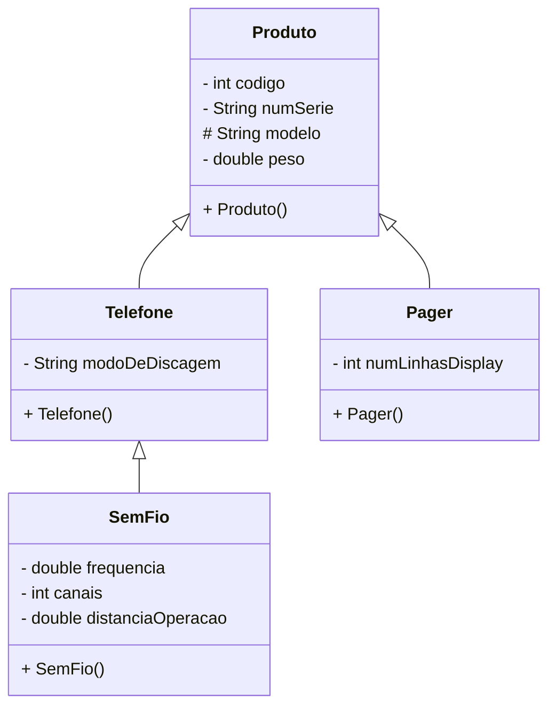

# Herança

- <b>Dica:</b> Se Classe 2 é um(a) Classe 1, então faz sentido Classe 2 herder da Classe 1
- Deixar um atributo `protected` possibilita o uso do atributo ser usado em diferentes classes que herdam dessa classe com o atributo

## Sistema para Cadastro de Produtos

### Diagrama UML

